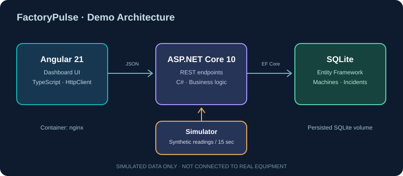

# FactoryPulse

**Industrial production monitoring & incident management — an open-source portfolio project.**

> **Portfolio demo, not a Bosch product.** FactoryPulse is an independently designed educational application inspired by common manufacturing digitalization workflows. All machine data is generated locally by a simulator. It is **not** connected to any factory, real PLC or industrial network.

[](#quality--status)


## Why this project?

An operations team needs a clear view of equipment health and a reliable workflow for recording and resolving issues. FactoryPulse addresses this with a full-stack web UI, REST API, relational persistence, time-series telemetry and a simple incident lifecycle.

## Key features

- **Overview KPIs** — machine count, live operating state, simulated output, open incidents
- **Machine inventory** — list and select factory assets across manufacturing lines
- **Telemetry chart** — temperature and vibration samples produced by a .NET `BackgroundService` every 15 seconds
- **Incident workflow** — create, acknowledge and resolve maintenance incidents
- **SQLite persistence** — machines, readings, incidents, indexes and relationships using EF Core
- **Frontend** — Angular standalone component, signals, typed `HttpClient` service, responsive dashboard
- **DevOps foundations** — Dockerfiles, Compose, GitHub Actions CI definition, unit tests, architecture notes

## Stack

| Layer | Tools |
| --- | --- |
| UI | Angular 21, TypeScript, HTML, CSS |
| API | C#, ASP.NET Core 10 Minimal APIs |
| Data | EF Core 10, SQLite |
| Test | xUnit (incident lifecycle rules) |
| Infrastructure | Docker, Docker Compose, nginx |
| Workflow | Git, GitHub Actions |

## Architecture



Client → `/api` → ASP.NET Core → EF Core → SQLite. A background service emits synthetic telemetry. There is no PLC integration yet.

## Quick start — local development

**Requirements:** .NET SDK 10 and a Node.js version supported by Angular 21 (Node 22.12+ on the 22 line, or supported 20/24 versions); see [Angular compatibility](https://angular.dev/reference/versions). Package installation requires network access.

Terminal 1:

```bash
dotnet restore backend/FactoryPulse.slnx
dotnet run --project backend/FactoryPulse.Api --launch-profile http
```

Terminal 2:

```bash
cd frontend
npm install
npm start
```

Visit **http://localhost:4200**. Angular's development proxy forwards `/api` to `http://localhost:5080`.

**API examples:**

```bash
curl http://localhost:5080/health
curl http://localhost:5080/api/overview
curl http://localhost:5080/api/machines
```

OpenAPI JSON is available at `http://localhost:5080/openapi/v1.json` when ASP.NET Core is running in Development mode.

## Quick start — Docker

```bash
docker compose up --build
```

Visit **http://localhost:8081**. Compose keeps SQLite files in a named Docker volume. Run `docker compose down -v` to remove the demo database.

## Tests

```bash
dotnet test backend/FactoryPulse.Tests/FactoryPulse.Tests.csproj
cd frontend && npm run typecheck && npm run build
```

The CI workflow runs equivalent checks on push and pull request. `package-lock.json` is not supplied in this first offline scaffold; after `npm install`, commit the generated lockfile and change CI and Docker to `npm ci` for reproducible installs.

## API endpoints

| Method | Route | Purpose |
| --- | --- | --- |
| GET | `/health` | Basic process health |
| GET | `/api/overview` | Summary metrics |
| GET | `/api/machines` | Machine list with latest telemetry |
| GET | `/api/machines/{id}/readings?limit=30` | Recent sensor readings |
| GET | `/api/incidents` | Most recent 50 incidents |
| POST | `/api/incidents` | Create incident |
| PATCH | `/api/incidents/{id}/status` | Advance incident state |

See [API reference](docs/API.md) for sample requests. API is intentionally unauthenticated for a **local educational demo**. Do not deploy it publicly before adding authentication, authorization and request hardening.

## Quality & status

**v0.1.0 — offline-created starter implementation, not yet runtime-validated.** Source, architecture and CI configuration have been prepared. A local `.NET` SDK, Docker engine and Angular dependencies were unavailable in the authoring environment, so a successful build, running screenshot, passed CI badge or deployment is **not claimed**. Verification commands are included above. The next milestone is to run them, fix any compatibility issues and capture a real screenshot.

Other known limitations: demo-only seed data, simulated sensors, no authentication, no EF Core migrations, basic validation, no E2E tests or production monitoring.

## Learning and interview materials

- [Türkçe adım adım öğrenme planı](docs/LEARNING_GUIDE_TR.md)
- [How this maps to engineering interview topics](docs/INTERVIEW_EVIDENCE_TR.md)
- [Architecture & design decisions](docs/ARCHITECTURE.md)
- [Prioritized roadmap](docs/ROADMAP.md)

## License

MIT. All names and simulated data in the demonstration are fictional; no affiliation with Bosch or Bosch Rexroth.
